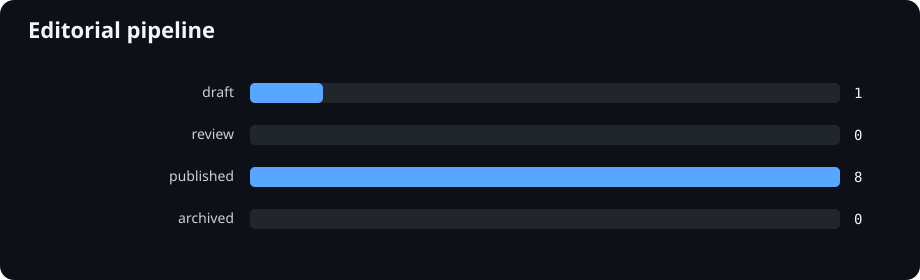
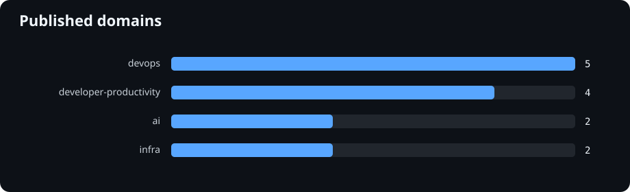
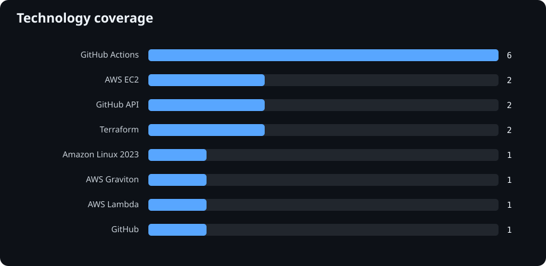
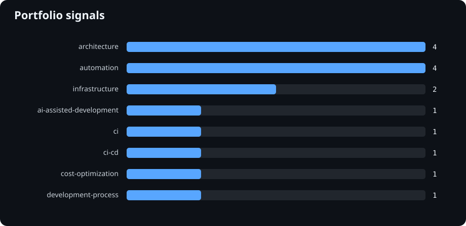
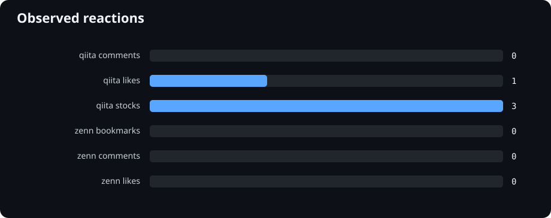

# Writing Analytics — Decision Dashboard

> Analytics as of: 2026-10-23 · Freshness as of: 2026-10-23 · Derived from Repository metadata / publication registry / stored metric snapshots

## まず見る

| 判断軸 | 現在 |
| --- | --- |
| Published | **8** |
| Pipeline | Draft **1** / Review **0** |
| Last published | **2026-09-15** |
| Source freshness | Initial verification **5** / Verified **3** |
| Metric snapshots | **58** / observed span **57d** |
| Data Quality | **3件 — 下のData Qualityを確認** |
| Pipeline-only coverage gaps | **3** |
| GitHub → Writing Funnel | Themes **86** / Events **163** |
| 次の記事候補 | [技術記事を書いていたら、「コードの外側」の方が気になってきた](../articles/draft/260827-engineer-thinking-place/article.md) (`draft`) |

### 今の判断

- GitHub実装の未記事化evidence **163件** を、明示scopeで **86 themes** に整理しています。先頭theme: `mizzz-ivr/profile-signal` / Profile Signal v0.4.0（1 events、代表: Profile Signal v0.4.0）。
- Published記事 **5件** はinitial verification未記録です。過去の確認日は推測せず、次回実確認時に `verified_at` を記録します。
- 7日Trendを実データだけで分析できる状態です。
- Data Quality findingが **3件** あります。記事追加より先に、必要ならmetadata整備対象として確認できます。
- 次記事候補の主な根拠: `communication`, `domains:developer-productivity (56d since last post)`, `technologies:GitHub (60d since last post)`

## Editorial Pipeline

## Coverage Gaps

draft / reviewにはあるが、公開済みPortfolioではまだ示せていないclassificationです。

- **topics:** `engineering`, `writing`
- **portfolio_signals:** `communication`

## GitHub → Writing Funnel

> GitHub snapshot as of: **2026-10-23**

最近のpublic Repository実装を、明示的なConventional Commit scopeだけでtheme groupingして表示します。scopeが無いeventは無理にまとめません。tracked evidenceを含む監査用全件はContent Opportunities / Data Martで確認します。意味的な重複や重要度は推測しません。

| Repository | Theme | Events | Representative evidence | Latest |
| --- | --- | ---: | --- | --- |
| `mizzz-ivr/profile-signal` | release | **1** | [Profile Signal v0.4.0](https://github.com/mizzz-ivr/profile-signal/releases/tag/v0.4.0) | 2026-08-27 |
| `mizzz-ivr/profile-signal` | release | **1** | [Profile Signal v0.3.0](https://github.com/mizzz-ivr/profile-signal/releases/tag/v0.3.0) | 2026-08-27 |
| `mizzz-ivr/roomate-voice` | release | **1** | [RooMate Voice v0.1.0 (Preview)](https://github.com/mizzz-ivr/roomate-voice/releases/tag/v0.1.0) | 2026-08-26 |
| `ivRooom/Herta` | scope `studio` | **19** | [fix(studio): page.view判定をpage描画時にも行い、ソフトナビゲーションでの権限取り消し漏れを防ぐ](https://github.com/ivRooom/Herta/pull/546) | 2026-10-21 |
| `ivRooom/Herta` | scope `ai` | **15** | [feat(ai): Guild単位の月次AI予算上限を追加する](https://github.com/ivRooom/Herta/pull/543) | 2026-10-21 |
| `ivRooom/Herta` | scope `vc-recap` | **10** | [fix(vc-recap): @discordjs/voiceを0.19系へ上げ、DAVE(E2EE)必須の音声チャンネルへ接続できるようにする](https://github.com/ivRooom/Herta/pull/547) | 2026-10-21 |
| `ivRooom/Herta` | scope `mbti` | **8** | [feat(mbti): 可愛いちびHertaのタイプ別画像へ差し替え](https://github.com/ivRooom/Herta/pull/484) | 2026-10-15 |
| `ivRooom/Herta` | scope `community` | **7** | [fix(community): ivrm-web同期を全メンバー対象に拡大(Issue #537)](https://github.com/ivRooom/Herta/pull/540) | 2026-10-20 |
| `ivRooom/Herta` | scope `ops` | **5** | [docs(ops): deploy workflowのSSM移行でシークレットをCloudTrailへ漏らさない設計を明記する](https://github.com/ivRooom/Herta/pull/425) | 2026-10-16 |
| `mizzz-ivr/ivmz-home` | scope `site` | **5** | [feat(site): About profile card, styled 404/500 pages, playful touches](https://github.com/mizzz-ivr/ivmz-home/pull/66) | 2026-10-14 |
| `mizzz-ivr/ivmz-home` | scope `contact` | **4** | [feat(contact): drag and drop, admin download link, richer admin email, Turnstile bot check](https://github.com/mizzz-ivr/ivmz-home/pull/57) | 2026-10-09 |
| `mizzz-ivr/ivmz-home` | scope `ops` | **3** | [docs(ops): record Netlify credit exhaustion and Production recovery](https://github.com/mizzz-ivr/ivmz-home/pull/68) | 2026-10-15 |

Raw untracked evidence **163件** → deterministic theme **86件**。Compression: **1.9x**。

Grouping: `release`は独立theme、`feat(scope)` / `fix(scope)`等は同一Repository内の明示scopeでgrouping、scope無しはsingleton。AI semantic clustering / significance scoreは使いません。

## Source Freshness

> Freshness as of: **2026-10-23**

技術的事実を最後に再確認した記録です。未記録の記事へ過去日付を推測して補完しません。現段階では任意のstale thresholdも置かず、initial verificationと経過日数をそのまま表示します。

| Article | Status | Verified at | Age | Commit refs |
| --- | --- | --- | ---: | ---: |
| [AI開発エージェントを「Repository is the Source of Truth」で動かしたら個人開発がかなり変わった話](../articles/published/repository-is-source-of-truth/article.md) | Needs initial verification | - | - | 0 |
| [GitHubプロフィールREADMEに「今日の開発活動」を自動表示してみた](../articles/published/github-profile-daily-activity/article.md) | Needs initial verification | - | - | 0 |
| [GitHubプロフィールをライブな開発ダッシュボードにしてみた](../articles/published/github-profile-live-dashboard/article.md) | Needs initial verification | - | - | 0 |
| [完成したと思ったコードが、PRを開いたら完成じゃなくなった](../articles/personal-dev-pr-ci.md) | Needs initial verification | - | - | 0 |
| [生成AIをAPI呼び出しで終わらせない — Secret・Quota・Kill Switchを分けるAI Runtime設計](../articles/ai-runtime-safety-boundary.md) | Needs initial verification | - | - | 0 |
| [自作GitHubプロフィールWidgetをStandalone OSSとして配布してみた](../articles/published/profile-signal-github-action/article.md) | Verified | 2026-08-28 | 56d | 0 |
| [GitHub Actionsの無料枠が尽きたので、AWSにセルフホストのGraviton runnerを立てた](../articles/published/260831-selfhosted-graviton-runner/article.md) | Verified | 2026-09-04 | 49d | 2 |
| [CI runnerを0台にしたかっただけなのに、2GBの壁とTerraformの「正解」にぶつかった](../articles/published/260831-runner-scale-to-zero-design/article.md) | Verified | 2026-09-15 | 38d | 3 |

## Portfolio Coverage

全classificationの詳細表は [Content Opportunities](./content-opportunities.md) に委譲し、ここでは分布だけを確認します。

### Domains

### Technologies

### Portfolio Signals

## Reactions

reaction chartはlikes / stocks / bookmarks / commentsのみを描画します。page viewsはData Martの観測値として保持します。`0` / `unavailable` / field missingは別状態で、単一のPopularity Scoreには集約しません。

| Article | Platform | Reactions / observed metrics |
| --- | --- | --- |
| [生成AIをAPI呼び出しで終わらせない — Secret・Quota・Kill Switchを分けるAI Runtime設計](https://zenn.dev/mizzz-ivr/articles/ai-runtime-safety-boundary) | zenn | metrics error |
| [完成したと思ったコードが、PRを開いたら完成じゃなくなった](https://zenn.dev/mizzz/articles/personal-dev-pr-ci) | zenn | likes 1 · bookmarks 0 · comments 0 · page_views unavailable |
| [CI runnerを0台にしたかっただけなのに、2GBの壁とTerraformの「正解」にぶつかった](https://qiita.com/mizzz-ivr/items/a9f22a303c22b774963c) | qiita | likes 0 · stocks 0 · comments 0 · page_views 314 |
| [GitHub Actionsの無料枠が尽きたので、AWSにセルフホストのGraviton runnerを立てた](https://qiita.com/mizzz-ivr/items/e4c663c7f5d3f82fd0a9) | qiita | likes 0 · stocks 0 · comments 0 · page_views 289 |
| [GitHubプロフィールREADMEに「今日の開発活動」を自動表示してみた](https://qiita.com/mizzz-ivr/items/73bd3a3874aa8adacc1a) | qiita | likes 0 · stocks 2 · comments 0 · page_views 280 |
| [GitHubプロフィールをライブな開発ダッシュボードにしてみた](https://qiita.com/mizzz-ivr/items/b5cc51f17c9d9e69f630) | qiita | likes 0 · stocks 0 · comments 0 · page_views 256 |
| [自作GitHubプロフィールWidgetをStandalone OSSとして配布してみた](https://qiita.com/mizzz-ivr/items/f20a2d58f623097a5904) | qiita | likes 1 · stocks 1 · comments 0 · page_views 381 |
| [AI開発エージェントを「Repository is the Source of Truth」で動かしたら個人開発がかなり変わった話](https://qiita.com/mizzz-ivr/items/44cd3077d732eea1bf6e) | qiita | likes 0 · stocks 0 · comments 0 · page_views 474 |

## Trend Readiness

- Snapshot count: **58**
- First snapshot: **2026-08-27**
- Latest snapshot: **2026-10-23**
- Observed span: **57 days**

| Window | Status |
| --- | --- |
| 7d | **Ready** |
| 30d | **Ready** |
| 90d | **Waiting** |

履歴不足時は推測・直線補間・synthetic historyを作りません。

## Data Quality

- `personal-dev-pr-ci`: `domains` が未分類
- `personal-dev-pr-ci`: `languages` が未分類
- `personal-dev-pr-ci`: `technologies` が未分類

## Analysis Data

- [Normalized Writing Analytics Data Mart](../data/analytics/writing-analytics.json) — 集計・分析用の共通derived JSON
- [Public Writing Portfolio JSON](../data/exports/writing-portfolio.json) — 外部公開向けstable schema
- [Writing Profile](./writing-profile.md) — 詳細テキスト分析
- [Content Opportunities](./content-opportunities.md) — coverage全件・次記事推薦の詳細

## Source of Truth

- Article metadata: `articles/**`
- Platform-native analytics evidence: `metadata/platform-native-analytics.yml`
- Publication registry: `ideas/published.md`
- Raw external metrics: `data/metrics/YYYY-MM-DD.json`
- Raw GitHub writing evidence: `data/github-funnel/YYYY-MM-DD.json`
- Data Mart / Dashboard / reports: **derived / regeneratable**
